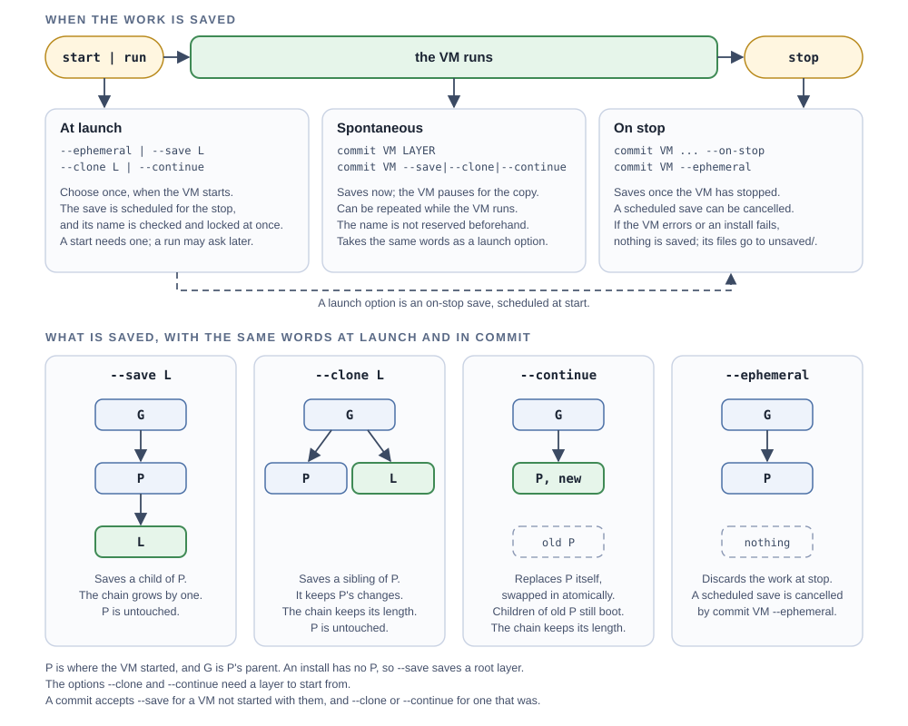

# terrarium

Boot macOS, Linux, and Windows guests on a Mac, then see and drive them from the command line or from an agent: take screenshots, click, type, press keys, and run commands. The same verbs are also a stdio [MCP](docs/specifications/README.md) tool (`terrarium mcp`).


[AGENTS.md](AGENTS.md) is the specification. This file explains how to use terrarium and adds no requirements of its own; how it works inside is in [core/README.md](core/README.md).

## What you need

* a Mac with Apple silicon, running macOS 27 or later
* Xcode, for `swiftc` and the SDK
* [Zig](https://ziglang.org) 0.17 or later

```
zig build
```

builds `zig-out/bin/terrarium`, signed with the entitlement Virtualization requires. Put it on your `PATH` to follow the walkthroughs. At run time terrarium calls only programs that ship with macOS and links no external libraries.

Xcode and Zig are needed only to build it. A prebuilt binary for Apple silicon is on the [releases page](https://github.com/idiomatic/terrarium/releases): unpack it and put it on your `PATH`.

> [!NOTE]
> The prebuilt binary is signed only ad hoc, not notarized, so Gatekeeper blocks one downloaded with a browser. Allow it under System Settings › Privacy & Security › Open Anyway, or clear the quarantine flag:
>
> ```
> xattr -d com.apple.quarantine terrarium
> ```

## Quick start

A Debian cloud image, headless:

```
base=https://cloud.debian.org/images/cloud/trixie/latest
terrarium pull $base/debian-13-genericcloud-arm64.raw
id=$(terrarium start debian-13 --provision cloud-init \
       --ephemeral --memory 2048 --cpus 2)
terrarium wait $id
terrarium exec $id uname -a
terrarium put $id ~/src/app /home/debian/app
terrarium shot $id > screen.png
terrarium commit $id dev
terrarium stop $id
terrarium start dev --ephemeral
```

1. `terrarium pull` prints the image's name.
2. `terrarium start` prints the VM's ID.
3. `terrarium commit` prints the layer it wrote, `.../layers/dev.layer`.
4. The layer already has the helper, so the last `start` needs no `--provision`.

[Layers](docs/layers.md) says more about saving and reusing a VM's work.

## How it works

Every VM starts the same way, then goes down one of two lanes: **INSTALL**, which turns an installer image into a layer, or **USE**, which runs a live image or a layer.

1. **`terrarium pull`** stores a disk image: a URL or a file, such as an ISO, an IPSW, or a raw or compressed disk. Stored images are read-only and named `NAME-HASH`; any unique prefix works as a name.
2. **`terrarium start`** boots a VM without a window and prints its ID (*headless*); **`terrarium run`** boots it in a window and stays until you close it (*interactive*). Both take an IMAGE, or a LAYER you saved.
3. **The lane follows the flag.** `--install RECIPE` (`windows`, `macos`, or `alpine`) sends the VM down INSTALL: the image is an *installer* (a Windows ISO, a macOS IPSW, or Alpine's ISO), which the recipe installs from and the VM never boots as is. Anything else goes down USE: the image is *live* (it boots as the base of the VM's disk, such as a Debian cloud image), or the VM starts from a saved layer. `--provision RECIPE` (`cloud-init`, `alpine`, or `nocloud`) readies a USE guest by putting the guest helper in, so that `terrarium exec` works.
4. **Drive it**, in either lane. `terrarium shot` takes a PNG of the screen, and `terrarium click`, `terrarium type`, and `terrarium key` act on it. `terrarium exec` runs a command in the guest and returns its output and exit status. `terrarium stop` stops any running VM, an install included. Verbs that act on a VM take it first, as `VM`: its ID or a unique prefix of it.
5. **Say what becomes of the VM's work.** It is lost when the VM stops unless saved as a layer; `terrarium start` needs you to choose (see [Layers](docs/layers.md)). After an install, `terrarium rmi` the installer to get its space back.

## Layers

A *layer* is a saved VM disk, a `NAME.layer` folder that holds the VM's changes and its own copy of what they sit on, so removing a parent harms no child. You choose what becomes of a VM's work when you start it, and `commit` can change that for a running VM:

| Option | When the VM stops |
|---|---|
| `--ephemeral` | the work is discarded |
| `--save CHILDLAYER` | saved as a new layer, a *child* of what you started from |
| `--clone SIBLINGLAYER` | saved as a *sibling* of the starting layer, which is left as it was |
| `--continue` | saved back to the starting layer, replacing it |



[docs/layers.md](docs/layers.md) has an example, naming, listing, sharing, and size.

## The interactive run window

`terrarium run` shows the VM in a window and stops it when you close the window; its menus are described in [ui/README.md](ui/README.md#using-the-window).

## Verbs

`terrarium help` lists the verbs, and `terrarium help VERB` shows a verb's arguments. `terrarium --version` shows the version. [docs/verbs.md](docs/verbs.md) groups the verbs with examples, and [docs/tweaks.md](docs/tweaks.md) catalogs the tweaks, which `--tweak TWEAK` on `start` and `run` applies once the guest's helper answers; save the layer to keep the change.

Recipes today: `--install` takes `alpine`, `windows`, and `macos`; `--provision` takes `alpine`, `cloud-init`, `combustion`, and `nocloud`.

## Use it from an agent

`terrarium mcp` serves every verb but `terrarium run` as an MCP tool on stdin and stdout; configure a client with `{"command": "terrarium", "args": ["mcp"]}`. [docs/mcp.md](docs/mcp.md) has configurations for Claude Code and OpenCode and advice for sharing the Mac with other sessions.

## Good to know

* `terrarium stop` powers the VM off; it does not ask the guest to shut down.
* `/bin/ps` shows a password given with `--password`.
* A guest's screen and keyboard are served on a loopback VNC port with no authentication, so any local process, including another user's, can watch and drive every running guest.
* terrarium relies on private Virtualization interfaces for the screen and keyboard, which can change with any macOS release.
* Windows and macOS guests are installed from the vendors' images under the vendors' licenses, which are yours to accept.
* Closing the `run` window's app at logout stops the VM but cancels the logout, so log out again.

## More

Walkthroughs, headless (`terrarium start`: no window, driven by commands or an agent) and interactive (`terrarium run`: a window you use yourself), with what it took to boot each OS:

* [Linux](docs/linux.md): Alpine, Debian, Fedora, and Ubuntu
* [macOS](docs/macos.md)
* [Windows](docs/windows.md)

Reference:

* [docs/verbs.md](docs/verbs.md): the verbs, with examples
* [docs/layers.md](docs/layers.md): saving, sharing, and removing layers
* [docs/mcp.md](docs/mcp.md): using terrarium from an agent
* [docs/tweaks.md](docs/tweaks.md): the tweak catalog
* [docs/distros.md](docs/distros.md): images to pull (Ubuntu, Debian, Fedora, Alpine, macOS, Windows, and more), how far each has been tested, and the recipe and tweaks for each
* [docs/specifications/README.md](docs/specifications/README.md): the external specifications

Inside:

* [core/README.md](core/README.md): how it works
* [ui/README.md](ui/README.md): the run window
* [core/recipes/macos](core/recipes/macos/README.md) and [core/recipes/windows](core/recipes/windows/README.md): what it took to install and drive each
* [DEVELOPMENT.md](DEVELOPMENT.md): building, testing, releasing, and what comes next

## Credits

terrarium was written with [Claude](https://claude.com/).

## License

BSD 3-Clause; see [LICENSE](LICENSE).
