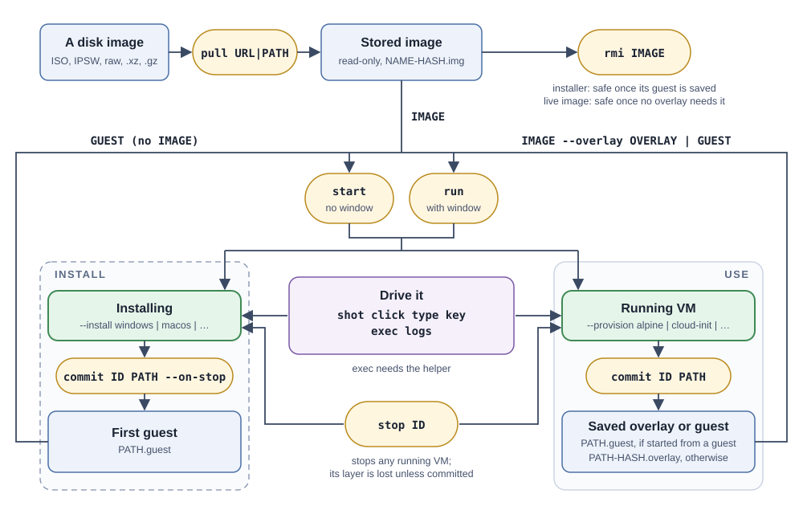

# terrarium

Boot macOS, Linux, and Windows guests on a Mac, then see and drive them from the command line or from an agent: take screenshots, click, type, press keys, and run commands. The same verbs are also a stdio [MCP](docs/specifications/README.md) tool (`terrarium mcp`).



[AGENTS.md](AGENTS.md) is the specification. This file explains how to use terrarium and adds no requirements of its own; how it works inside is in [core/README.md](core/README.md).

## What you need

* a Mac with Apple silicon, running macOS 27 or later
* Xcode, for `swiftc` and the SDK
* [Zig](https://ziglang.org) 0.17 or later

```
zig build
```

builds `zig-out/bin/terrarium`, signed with the entitlement Virtualization requires. Put it on your `PATH` to follow the walkthroughs. At run time terrarium calls only programs that ship with macOS and links no external libraries.

## The flow

Every VM starts the same way, then goes down one of two lanes: **INSTALL**, which turns an installer image into a guest, or **USE**, which runs a live image or a guest.

1. **`terrarium pull`** stores a disk image: a URL or a file, such as an ISO, an IPSW, or a raw or compressed disk. Stored images are read-only and named `NAME-HASH`; any unique prefix works as a name.
2. **`terrarium start`** boots a VM without a window and prints its ID (*headless*); **`terrarium run`** boots it in a window and stays until you close it (*interactive*). Both take an IMAGE, or the saved item you are starting again (step 6).
3. **The lane follows the flag.** `--install RECIPE` (`windows`, `macos`, or `alpine`) sends the VM down INSTALL: the image is an *installer* (a Windows ISO, a macOS IPSW, or Alpine's ISO), which the recipe installs from and the VM never boots as is. Anything else goes down USE: the image is *live* (it boots as the base of the VM's disk, such as a Debian cloud image), or the VM starts from a saved guest. `--provision RECIPE` (`cloud-init`, `alpine`, or `nocloud`) readies a USE guest by putting the guest helper in, so that `terrarium exec` works.
4. **Drive it**, in either lane. `terrarium shot` takes a PNG of the screen, and `terrarium click`, `terrarium type`, and `terrarium key` act on it. `terrarium exec` runs a command in the guest and returns its output and exit status. `terrarium stop` stops any running VM, an install included. Verbs that act on a VM take `--vm ID`; without it they use the only running VM.
5. **`terrarium commit`** saves the VM's disk changes. Every VM writes to its own layer, and the layer is discarded when the VM stops unless you committed it. An install saves its first *guest*, a `NAME.guest` directory, and needs `--on-stop`, because the installer powers the VM off. A VM started from a live image saves an *overlay*, which depends on that image. A VM started from a guest saves a new guest, which depends on nothing, unless you start it with `--overlay`: then it saves an overlay, which depends on that guest. A window's `--commit-on-stop PATH` is `commit PATH --on-stop`; a headless VM is kept with `commit` before `stop`, and a plain `stop` discards its changes.
6. **Start again from what you saved:** `terrarium start IMAGE --overlay OVERLAY` for an overlay, `terrarium start GUEST` for a guest, which needs no image, or `terrarium start GUEST --overlay OVERLAY` for an overlay over a guest. After an install, `terrarium rmi` the installer to get its space back. A live image can go once no overlay needs it.

`terrarium help` lists the verbs, and `terrarium help VERB` shows a verb's arguments.

## Quick start

A Debian cloud image, headless:

```
mkdir -p ~/vms
base=https://cloud.debian.org/images/cloud/trixie/latest
terrarium pull $base/debian-13-genericcloud-arm64.raw
id=$(terrarium start debian-13 --provision cloud-init \
       --memory 2048 --cpus 2)
until terrarium exec true 2>/dev/null; do sleep 2; done
terrarium exec uname -a
terrarium shot > screen.png
overlay=$(terrarium commit $id ~/vms/dev)
terrarium stop $id
terrarium start debian-13 --overlay $overlay
```

1. `terrarium pull` prints the image's name.
2. `terrarium start` prints the VM's ID.
3. `terrarium commit` prints the file it wrote: the path you gave, a dash, the image's hash, and `.overlay`.
4. The overlay already has the helper, so the last `start` needs no `--provision`.

## The interactive run window

* The title shows the VM's state. Closing the window stops the VM.
* *File* menu: *Commit…* and *Commit When VM Stops…* (what `terrarium commit` does), *Screenshot…*, *Reveal VM Folder*, and *Copy VM ID*.
* *Edit* menu: *Paste to Guest* (Command-V) and *Copy from Guest* (Command-C) move text between the host's pasteboard and the guest's clipboard; *Share Clipboard* (off by default) does it whenever the window gains or loses focus. Both need a running guest with a helper.
* *VM* menu: *Pause*; *Send Key*, for chords the host keeps, such as Ctrl+Alt+Delete or Cmd+Tab (Escape and the guest OS's own shortcuts, each named by its effect); and *Capture System Keys*, off by default so Cmd-Tab and screenshots stay yours (turn it on to give the guest every shortcut).
* *Window* menu: *Console Log*.

## Guides

Headless (`terrarium start`: no window, driven by commands or an agent) and interactive (`terrarium run`: a window you use yourself) walkthroughs, with what it took to boot each OS:

* [Linux](docs/linux.md): Alpine, Debian, Fedora, and Ubuntu
* [macOS](docs/macos.md)
* [Windows](docs/windows.md)

Waiting loops use `terrarium exec true`, which fails until the guest's helper answers.

## Verbs

* images: `pull` (a URL or a file), `images`, `rmi`
* lifecycle: `start` (headless), `run` (in a window; CLI only), `commit`, `stop`, `ps`
* observe and control: `shot`, `logs`, `click`, `type`, `key`, `exec`, `clipboard`
* tweaks: `tweak` runs an embedded OS-specific script in the guest, and `--tweak NAME` on `start` and `run` does the same once the guest's helper answers; run one, then `terrarium commit` to keep it

Recipes today: `--install` takes `alpine`, `windows`, and `macos`; `--provision` takes `alpine`, `cloud-init`, and `nocloud`. [docs/verbs.md](docs/verbs.md) details every verb and option, and [docs/tweaks.md](docs/tweaks.md) catalogs the tweaks and says how they fail.

## Use it from an agent

`terrarium mcp` serves every verb but `terrarium run` as an MCP tool on stdin and stdout. A client configuration:

```
{"command": "terrarium", "args": ["mcp"]}
```

VMs outlive the server. `terrarium exec` returns stdout, stderr, and the exit status, and a client's cancellation kills the guest's process.

## Good to know

* `terrarium stop` powers the VM off; it does not ask the guest to shut down.
* `/bin/ps` shows a password given with `--password`.
* `terrarium pull` converts qcow2 images (version 2 or 3, with plain or zlib-compressed clusters) to raw disks, and extracts the disk image from a tar archive that holds just one file (a `.tar.gz` of `disk.raw`, say). It cannot read qcow2 images with a backing file, encryption, or zstd compression, or choose among the files of a larger archive.
* A guest's screen and keyboard are served on a loopback VNC port with no authentication, so any local process, including another user's, can watch and drive every running guest.
* On Linux, the clipboard needs `wl-clipboard` or `xclip` and a graphical session the root helper can reach; on most desktops it cannot, and `clipboard set` types the text instead.
* Closing the `run` window's app at logout stops the VM but cancels the logout (the VM's stop cannot finish otherwise), so log out again.
* terrarium relies on private Virtualization interfaces for the screen and keyboard, which can change with any macOS release.
* Windows and macOS guests are installed from the vendors' images under the vendors' licenses, which are yours to accept.

## More

* [docs/verbs.md](docs/verbs.md): every verb, its options, and examples
* [docs/distros.md](docs/distros.md): images to pull (Ubuntu, Debian, Fedora, Alpine, macOS, Windows, and more), how far each has been tested, and the recipe and tweaks for each
* [docs/tweaks.md](docs/tweaks.md): the tweak catalog, and how to write one
* [docs/linux.md](docs/linux.md), [docs/macos.md](docs/macos.md), and [docs/windows.md](docs/windows.md): walkthroughs
* [core/README.md](core/README.md): how it works inside
* [core/recipes/macos](core/recipes/macos/README.md) and [core/recipes/windows](core/recipes/windows/README.md): what it took to install and drive each
* [docs/specifications/README.md](docs/specifications/README.md): the external specifications

## Credits

terrarium was written with [Claude](https://claude.com/).

## License

BSD 3-Clause; see [LICENSE](LICENSE).
