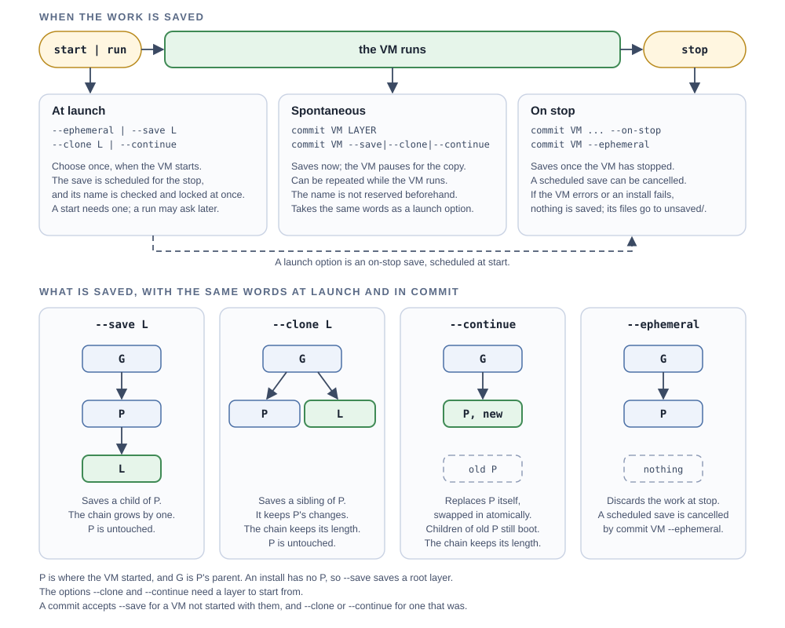

# Layers

A *layer* is a saved VM disk: a `NAME.layer` folder holding the VM's changes and its own copy of everything those changes sit on. An install saves a *root layer*, which needs no image. Anything else saves a layer that descends from the image or layer you started from. [AGENTS.md](../AGENTS.md#layers) holds the requirements.

## Choosing what is saved

You choose where a VM's work goes when you start it, and can change that later with `commit`:

| Option | When the VM stops | Chain |
|---|---|---|
| `--ephemeral` | the work is discarded | nothing is saved |
| `--save CHILDLAYER` | the work is saved as a new layer named CHILDLAYER, a *child* of the image or layer you started from | one longer |
| `--clone SIBLINGLAYER` | the work is saved as SIBLINGLAYER, a *sibling* of the starting layer: it keeps the starting layer's changes plus yours, and the starting layer is left as it was | the same length |
| `--continue` | the work is saved back to the starting layer, which is replaced atomically | the same length |

`--clone` and `--continue` start from a layer, not an image. A `--continue` VM that wrote nothing replaces nothing, so the layer keeps its identity; the other options save what you asked for. `--save-sibling` and `--save-over` are the same options as `--clone` and `--continue`, under names that say they are outputs.

`terrarium commit VM` takes the same words for a VM that is already running (`--save`, `--clone`, `--continue`, and `--ephemeral`, which cancels a scheduled save), saving now or, with `--on-stop`, when the VM stops. A bare `commit VM LAYER` is shorthand for `--save`, or for `--clone` when the VM started with `--clone` or `--continue`. A plain `stop` discards what nothing saved.



```
terrarium start debian-13 --provision cloud-init \
  --save base
terrarium start base --save toolchain
terrarium start toolchain --clone experiment
terrarium start experiment --continue
terrarium layers
terrarium rm experiment
```

`base` descends from the Debian image, `toolchain` from `base`, `experiment` is a copy of `toolchain` that kept what you did, and `--continue` keeps working in `experiment` without making the chain longer. Pick `--save` for a base you want to keep, `--clone` to try something without touching the original, and `--continue` to carry on one piece of work over many sessions.

## Naming

A bare `NAME` is a layer in the layer store, `~/Library/Application Support/terrarium/layers/NAME.layer`. An argument with a `/`, a leading `~`, or ending `.layer` is that path, so a layer can live (and be moved) anywhere. A name that is both an image's and a layer's is refused. `commit` and the save options will not overwrite an existing layer, except that `--continue` replaces the one it started from.

## Listing and removing

`terrarium layers` shows the store as a tree, images with layers at the top and each layer under its parent, with the size of its own changes (DELTA) and of the copies of its ancestors (CHAIN, which share disk blocks with the originals). A layer whose parent is gone shows as `(gone: ID)`. A layer that a running VM will save is listed too, under the parent it will have, marked `(saved when VM ID stops)`, and a layer it will replace is marked `(replaced when VM ID stops)`; a layer is not in the store until its VM stops, which is also why an install's layer does not appear until then. `terrarium rm LAYER` removes one, but not while a running VM started from it.

## Parents are optional

Each layer holds its own copy of its ancestors' files, made by cloning (free on the same APFS volume until they diverge). So removing a parent, even the image, leaves its children whole, and a layer can be moved anywhere. Copying one with `cp -c` clones it, and plain `cp` keeps its files sparse on another volume; `ditto` and `rsync` write each file out in full, which can take far more space than the original did.

## Squashing

Every layer in a chain adds a little to each read the guest makes that is not cached (under a microsecond a layer), and a chain keeps the space of everything its layers wrote, even what a later one deleted. `terrarium squash LAYER NEWLAYER` saves NEWLAYER, one layer with the same contents as LAYER, made directly from the image (or the blank disk under an install); `--onto ANCESTOR` keeps the chain up to that layer and squashes only what is above it. LAYER is left as it is, so remove it with `rm` once NEWLAYER is what you start from.

No VM runs: terrarium attaches the two chains on the Mac, copies only the blocks that differ, and checks that NEWLAYER reads exactly as LAYER does before it saves it. It takes about as long as reading the disk twice (a 40 GB Windows disk took 85 s), however much the guest wrote. Starting a layer more than 32 deep suggests it.

## Clean saves

Before it saves, terrarium asks the guest to write its disk (`sync`, or flushing `C:` on Windows), so a layer holds what the guest has done even if it never flushed. A guest with no helper, such as an installer or a console, is saved as it is, with a note. A Windows guest saved this way, with no shutdown, came back with every file intact and a healthy NTFS volume (`chkdsk` found no problems). Shutting the guest down first is still the cleanest save, and Windows' first-boot setup needs it (see [the Windows walkthrough](windows.md)).

## Keeping layers small

A layer grows with what the guest writes, and deleting files does not shrink it. Run the `trim` tweak before you save (`--tweak trim` on Windows or Linux): it tells the virtual disk which blocks are free.

## Several VMs at once

Many VMs may start from one layer, each writing its own delta; only one may save to a given name. The VM (or `squash`) that will save a layer holds a lock on its name, so a second one aiming at it is refused when it starts, not when it stops. A VM clones the layer it starts from, so a `--continue` VM that replaces the layer does not change what another VM started from it reads or saves; that VM keeps the old contents until it stops. If a `--continue` VM's layer is moved or removed meanwhile, its save at stop is refused, not recreated under the old name, and its files are kept in `unsaved/`. If a VM or the Mac dies, the layer is as the last save left it.

How layers work inside is in [core/README.md](../core/README.md#layers).
